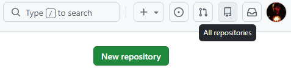
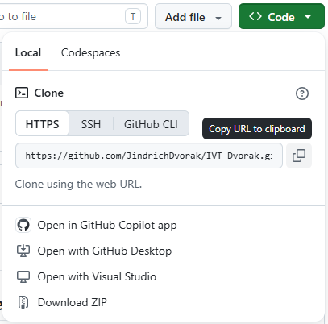

# IVT-Dvorak

## Jak si vytvořit vlastní veřejně dostupnou webovou stránku?

> Návod, jak přejít z `GitHub` repozitáře na veřejně dostupnou webovou stránku (neobsahuje podrobné informace o `HTML`, `CSS` ani `JS`).

> Předpokládáme, že již máme vlastní účet na `github.com`, a že na počítači máme nainstalovaný `git`.

**1. Pod vlastním `GitHub` účtem si vytvoříme nový repozitář:**

- Po kliknutí na ikonku `All repositories` klikneme na zelené tlačítko `New repository`.

  

- Název repozitáře si můžeme zvolit libovolně, ale měli bychom mít na vědomí následující omezení a standardy (pro názvy webových stránek):
    - Název **nesmí** obsahovat diakritiku.
    - Název **nesmí** obsahovat speciální znaky (!, ?, $, ...).
    - Název by **neměl** obsahovat velká písmena.
    - Pokud je název složen z více slov, nebo výrazů, tak bychom je měli oddělit symbolem `-` (pomlčka), nebo `.` (tečka). Obecně bychom měli preferovat pomlčku.  

    **Např:** Logic Circuits $\Rightarrow$ `logic-circuits`.
- Zaškrtneme možnost, která nám automaticky vloží do našeho repozitáře soubor `README.md`.
- Vytvoříme repozitář (je na nás, jestli bude `public`, nebo `private`).

**2. Naklonování repozitáře na lokální disk:**

- Po vytvoření nového repozitáře se nám automaticky otevře odpovídající `GitHub` stránka, na které klikneme na zelené tlačítko `Code`.
- Otevře se vyskakovací okno, ve kterém v sekci `Clone` zvolíme možnost `HTTPS` a následně zkopírujeme zobrazený odkaz (`Copy URL to clipboard`), který v následujícím bodě označujeme jako `your_URL`.

  

- Otevřeme si příkazový řádek (`cmd`) ve složce, do které budeme chtít repozitář naklonovat (přirozeně by se tedy tato složka mohla jmenovat `repos`) $\Rightarrow$ Pokud jsme na školní doméně, tak repozitář **nesmíme** klonovat na osobní disk `O:/`.  
 **$\Rightarrow$ Příkaz v `cmd`:** `git clone your_URL`
- Ve zvolené složce vznikne nová podsložka nesoucí název našeho repozitáře. Tuto složku si otevřeme v programu `Visual Studio Code`